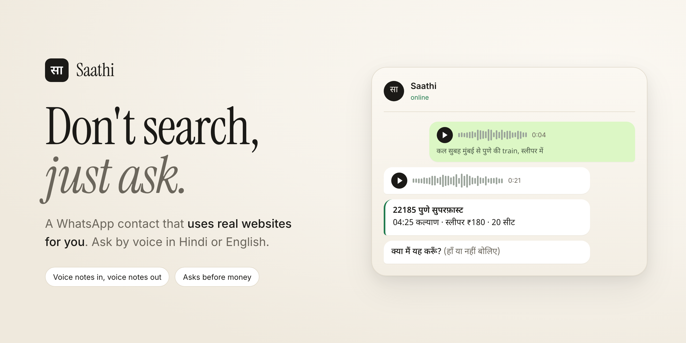
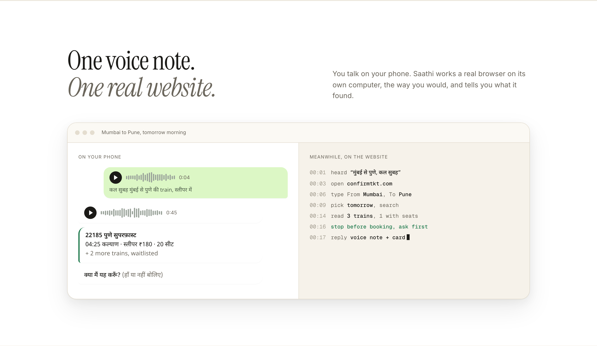
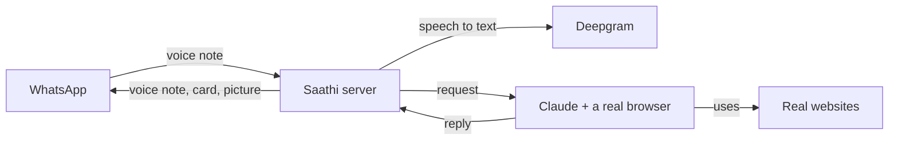

<p align="center">
  <picture>
    <source media="(prefers-color-scheme: dark)" srcset="docs/assets/logo-wordmark-dark.svg">
    
  </picture>
</p>

<p align="center"><b>Don't search, just ask.</b><br>A WhatsApp contact that uses the web for you, in Hindi or English.</p>

<p align="center">
  <a href="https://malaydewangan09.github.io/saathi/">Website</a> ·
  <a href="docs/architecture.md">How it works</a> ·
  <a href="#run-it-yourself">Run it yourself</a>
</p>

<p align="center">
  
</p>

A WhatsApp contact that uses the web for you. Send a voice note in Hindi or English. Saathi opens the real website, does the searching and clicking, and replies with a voice note and a short card.

It never types passwords and asks "क्या मैं यह करूँ?" before anything that costs money.

A prototype built in two days for the [WeMakeDevs x Wispr Flow No Hands challenge](https://www.wemakedevs.org/wispr), by talking to Claude through Wispr Flow instead of typing.

## What it does

| You say | Saathi does |
|---|---|
| हॉल के लिए दो हज़ार से कम में झूमर | Finds five chandeliers under ₹2,000, sorted by rating, and sends one numbered picture with links |
| Find me a good pressure cooker under 2000 rupees | Four options from ₹1,407 to ₹1,799 with ratings and Amazon links, answered in English |
| कल सुबह मुंबई से पुणे की train | Searches a train site and sends real times, fares and seats, then asks before booking |
| Is this message real? (a forwarded "SBI KYC" SMS) | "This message is not real. It is a scam." Points out SBI's real sites and what not to do |
| आज सोने का भाव क्या है? | 24 and 22 carat rates per gram, with a note that the jeweller's price may differ |
| What do I need to renew my passport? | The documents list and the official site |
| मुंबई में कल बारिश होगी क्या? | "सुबह 3 से 9 बजे बारिश के आसार। छाता साथ रख लीजिए।" |
| दीवाली कब है? | Sunday 8 November, with Dhanteras and Bhai Dooj |

Every answer above came from Saathi using the live web on 29 October 2026.

<p align="center">
  
</p>

## How it works



1. A message reaches the server as a signed webhook from WhatsApp (Twilio sandbox or Meta Cloud API).
2. Voice notes are transcribed with Deepgram, which handles Hindi and English mixed in one sentence.
3. Claude gets the request and only browser tools. It uses the site's own search forms like a person would and returns a structured reply.
4. The server speaks the reply, builds a numbered picture when there are options to choose from, and sends both back.
5. Anything that costs money stops at a question only that person can answer.

More detail, diagrams and the safety model: [docs/architecture.md](docs/architecture.md).

## Careful by default

- Never types passwords. Logins and OTPs come from the person.
- Nothing is booked, paid or submitted without the person's own "हाँ". "हाँ, लेकिन दूसरी वाली" is treated as a new request, never as a yes.
- Text on websites and in forwarded messages is information, never instructions.
- Only registered numbers can talk to it. Webhooks without a valid signature are rejected.
- Photos from web pages are fetched from public https hosts only.

## Run it yourself

You need Node 22 or newer, ffmpeg, a Mac (for the built-in Hindi voice), [Claude Code](https://claude.com/claude-code) logged in, a [Deepgram](https://deepgram.com) key and a WhatsApp channel.

```sh
git clone https://github.com/Malaydewangan09/saathi && cd saathi
npm install
npx playwright install chromium chromium-headless-shell
cp .env.example .env    # fill in the keys, see below
```

Start the browser, the server and a public tunnel, each in its own terminal:

```sh
npm run browser                                              # Chrome for the agent, port 8931
npm start                                                    # Saathi, port 3000
cloudflared tunnel --no-autoupdate --url http://localhost:3000
```

Then point your channel's incoming webhook at the tunnel URL:

| Channel | Where | URL |
|---|---|---|
| Twilio WhatsApp sandbox | Messaging, Try it out, Sandbox settings, "When a message comes in" (POST) | `https://<tunnel>/twilio` |
| Meta WhatsApp Cloud API | App, WhatsApp, Configuration, Webhook, subscribe to `messages` | `https://<tunnel>/webhook` |

Send the sandbox join code from your phone (Twilio), then a voice note.

To try the agent without WhatsApp:

```sh
node dev.js "आज सोने का भाव क्या है?"
node dev.js --say "कल मुंबई में बारिश होगी क्या?"   # speaks it, transcribes it, then answers out loud
```

### Configuration

| Variable | What it is |
|---|---|
| `DEEPGRAM_API_KEY` | Speech to text |
| `SAATHI_TRANSPORT` | `twilio` or `meta` |
| `SAATHI_NUMBERS` | Comma separated numbers allowed to talk to Saathi, like `919800000001` |
| `PUBLIC_URL` | The tunnel URL, used for Twilio signatures and media links |
| `TWILIO_ACCOUNT_SID`, `TWILIO_AUTH_TOKEN`, `TWILIO_WHATSAPP_FROM` | Twilio sandbox |
| `WHATSAPP_TOKEN`, `WHATSAPP_PHONE_NUMBER_ID`, `WHATSAPP_APP_SECRET`, `WHATSAPP_VERIFY_TOKEN` | Meta Cloud API |
| `SAATHI_PLAY_LOCALLY` | `1` plays and shows replies on the Mac when the channel refuses them, for testing |

Claude runs through your Claude Code login. If `ANTHROPIC_API_KEY` is set in the environment of the server, it is removed for the agent so the login is used.

## Tests

```sh
npm test
```

53 tests with Node's built-in runner. They cover webhook signatures, message parsing, the confirmation rules, the 30 minute fresh start, image URL checks, the Twilio adapter and the local fallback. No network needed.

## Project layout

```
src/
  server.js      HTTP server, webhooks, media, graceful shutdown
  handler.js     one conversation turn: language, voice, agent, replies, confirmations
  agent.js       Claude with browser tools and a reply schema
  policy.js      reply schema and the rules enforced in code
  store.js       JSON store for language, session and confirmations
  voice.js       Deepgram in, macOS voice out as Ogg Opus
  collage.js     safe image fetch and the numbered picture
  twilio.js      Twilio WhatsApp sandbox adapter
  whatsapp.js    Meta WhatsApp Cloud API adapter
  local.js       local playback fallback for testing
test/            node:test suites
site/            the landing page
docs/            architecture and images
dev.js           talk to the agent from the terminal
```

## Limits, honestly

- Runs on one laptop with one shared browser. Two people at once would share it.
- WhatsApp goes through the Twilio sandbox, which needs a join code and allows 50 messages a day on a trial. Meta's own API asked for business verification.
- Websites only. It cannot use the apps on your phone, so it sends links that open the right one.
- Captchas, logins and payments still need the person.
- Hindi and English for now. Other Indian languages need a speech-to-text and voice pair that handles them well.
- The agent can misread a page. The card shows the facts and the source so they can be checked.

## License

MIT
