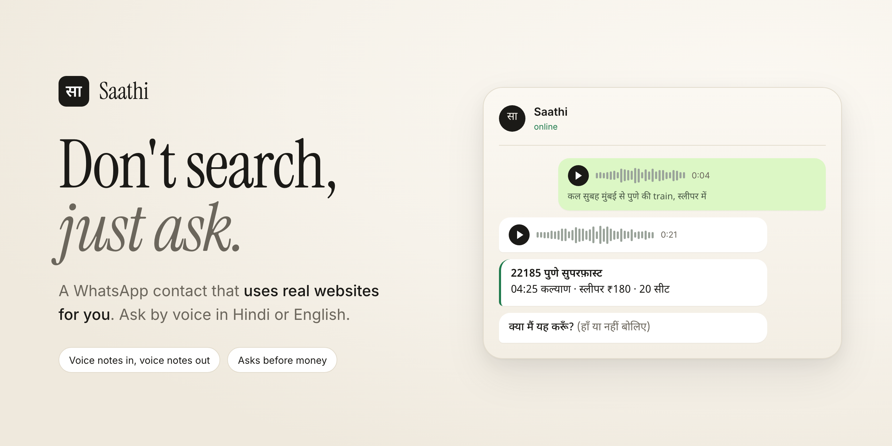
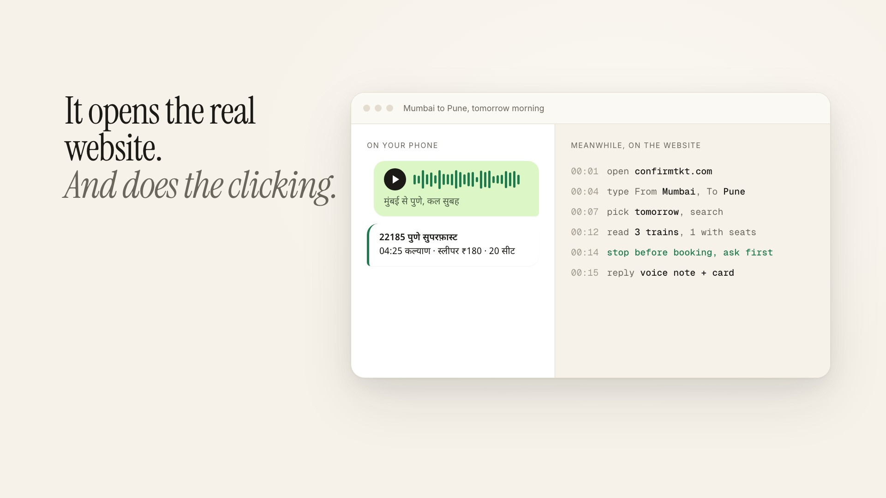
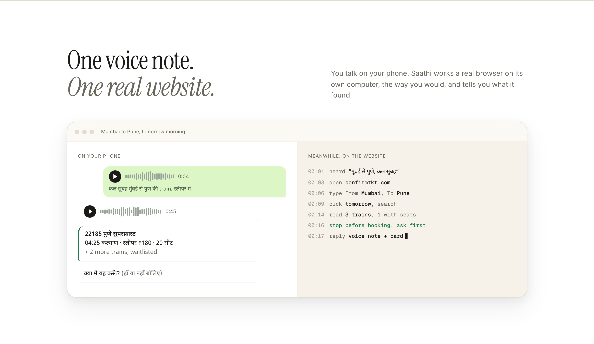
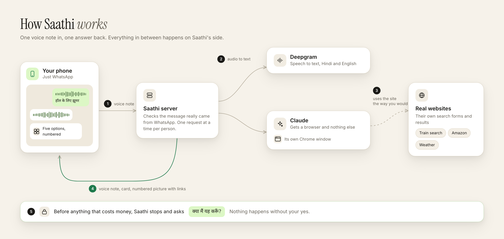

<p align="center">
  <picture>
    <source media="(prefers-color-scheme: dark)" srcset="docs/assets/logo-wordmark-dark.svg">
    
  </picture>
</p>

<p align="center"><b>You talk. Saathi does the clicking.</b><br>The internet, by voice note. On WhatsApp, in Hindi or English.</p>

<p align="center">
  <a href="https://malaydewangan09.github.io/saathi/">Website</a> ·
  <a href="https://malaydewangan09.github.io/saathi/#demo">Demo</a> ·
  <a href="docs/architecture.md">How it works</a> ·
  <a href="#run-it">Run it</a>
</p>

<p align="center">
  
</p>

Most of the internet is in English and full of forms. A lot of people would rather just ask someone.

### Demo (1:46)

[](https://malaydewangan09.github.io/saathi/assets/saathi-demo.mp4)

A WhatsApp voice note becomes a real train search on a booking site, plus a quick look at the website's live preview chat. [Watch the video](https://malaydewangan09.github.io/saathi/assets/saathi-demo.mp4).

So you send Saathi a voice note on WhatsApp. It opens the real website, does the clicking, and answers with a voice note and a short card. It never types your passwords, and it asks "क्या मैं यह करूँ?" before anything that costs money.

## Things people asked it

| Asked | Got |
|---|---|
| हॉल के लिए दो हज़ार से कम में झूमर | Five chandeliers under ₹2,000 in one numbered picture, with links |
| Find me a good pressure cooker under 2000 rupees | Four options with ratings and Amazon links |
| कल सुबह मुंबई से पुणे की train | Real trains and seats, then "क्या मैं यह करूँ?" |
| Is this message real? (an "SBI KYC" SMS) | "This message is not real. It is a scam." |
| आज सोने का भाव क्या है? | Today's 22 and 24 carat rate |
| मुंबई में कल बारिश होगी क्या? | "छाता साथ रख लीजिए।" |

All real answers from the live web, 29 October 2026.

<p align="center">
  
</p>

## How it works

<p align="center"></p>

1. Your voice note reaches a small Node server.
2. Deepgram turns it into text. Hindi, English or both in one sentence.
3. Claude gets the request and a browser, nothing else. It uses the site the way you would.
4. The answer comes back as a voice note, plus a card or a numbered picture with links.
5. Anything that costs money stops at a question only you can answer.

More detail and the safety rules: [docs/architecture.md](docs/architecture.md).

## Run it

Saathi runs on your own Mac, with your own accounts. Nothing is shared with anyone else.

You need macOS (for the Hindi and English voices), Node 22+, ffmpeg (`brew install ffmpeg`) and [Claude Code](https://claude.com/claude-code) logged in. The agent runs on your Claude Code login.

### 1. Try it in the terminal (2 minutes, no WhatsApp)

```sh
git clone https://github.com/Malaydewangan09/saathi && cd saathi
npm install && npx playwright install chromium chromium-headless-shell

npm run browser                                   # the agent's browser, leave it running
node dev.js "कल सुबह मुंबई से पुणे की ट्रेन देखो"      # in a second terminal
```

A Chrome window opens and does the search, then the reply is printed and spoken. Add `--new` to start a fresh conversation, `--mute` for no sound.

### 2. On WhatsApp (about 15 minutes, free)

1. Get a [Deepgram](https://deepgram.com) key (free credit) for voice notes, and `brew install cloudflared` for the tunnel.
2. Open the [Twilio WhatsApp sandbox](https://console.twilio.com/us1/develop/sms/try-it-out/whatsapp-learn). Note the sandbox number and the join code, and send the join code from your phone.
3. `cp .env.example .env` and fill in `DEEPGRAM_API_KEY`, `TWILIO_ACCOUNT_SID`, `TWILIO_AUTH_TOKEN`, `TWILIO_WHATSAPP_FROM` (`whatsapp:+<sandbox number>`) and `SAATHI_NUMBERS` (your number, country code, no `+`).
4. Run these, each in its own terminal:

   ```sh
   npm run browser
   cloudflared tunnel --url http://localhost:3000    # prints a https://...trycloudflare.com address
   ```

5. Put that address in `.env` as `PUBLIC_URL`, then `npm start`.
6. In the sandbox settings, set "When a message comes in" to `<PUBLIC_URL>/twilio` (POST) and save.
7. Send Saathi a voice note.

Only the numbers in `SAATHI_NUMBERS` get an answer. The sandbox allows 50 messages a day, and the tunnel address changes each time it starts (update `PUBLIC_URL` and the sandbox URL when it does). `SAATHI_PLAY_LOCALLY=1` plays replies on the Mac if WhatsApp refuses them.

`npm test` runs 85 tests. No network needed.

### 3. Your own website chat (optional)

The "Try it" chat on the website is a small Vercel function (`api/ask.js`) using Groq's free tier, no Mac needed. Import your fork into [Vercel](https://vercel.com/new), set `GROQ_API_KEY` ([console.groq.com](https://console.groq.com)) and `SAATHI_WEB_ORIGIN` (your site's address), and point `site/live.json` at your Vercel URL. GitHub Pages serves `site/` from `.github/workflows/pages.yml`.

## Honest limits

It runs on one laptop with one browser, through the Twilio sandbox. It can't use the apps on your phone, so it sends links that open them. Captchas, logins and payments still need you. Hindi and English for now.

## Built by voice

Built by talking to Claude through Wispr Flow instead of typing.

## Contributing

Fork it, run your own, and open an issue or a pull request if something breaks or you add a language. Keep changes small and run `npm test` first.

MIT licensed.
