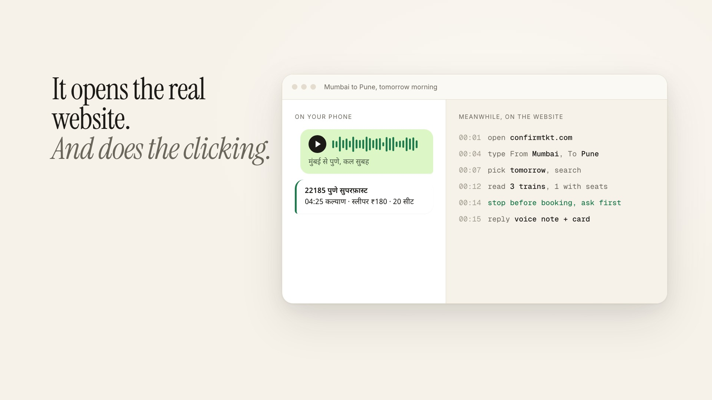
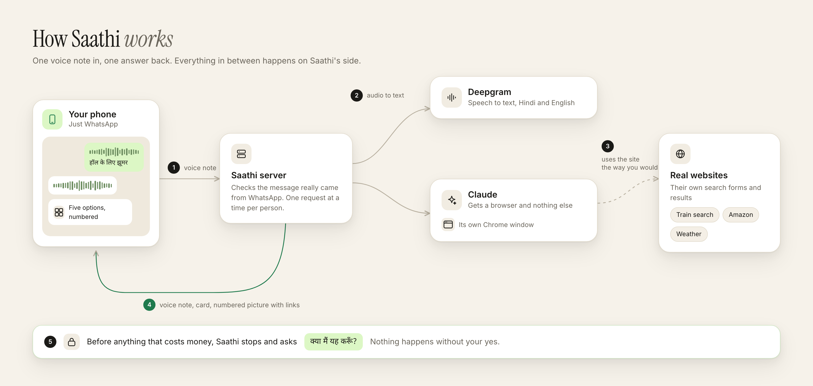

<p align="center">
  <picture>
    <source media="(prefers-color-scheme: dark)" srcset="docs/assets/logo-wordmark-dark.svg">
    
  </picture>
</p>

<p align="center"><b>You talk. Saathi does the clicking.</b><br>The internet, by voice note. On WhatsApp, in Hindi or English.</p>

<p align="center">
  <a href="https://malaydewangan09.github.io/saathi/">Website</a> ·
  <a href="https://malaydewangan09.github.io/saathi/#demo">Demo</a> ·
  <a href="docs/architecture.md">How it works</a> ·
  <a href="#run-it">Run it</a>
</p>

<p align="center">
  
</p>

Most of the internet is in English and full of forms. A lot of people would rather just ask someone.

### Demo (1:46)

[](https://malaydewangan09.github.io/saathi/assets/saathi-demo.mp4)

A Hindi voice question and a scam check on the live website, then a real train search on a booking site, by voice note. [Watch the video](https://malaydewangan09.github.io/saathi/assets/saathi-demo.mp4).

So you send Saathi a voice note on WhatsApp. It opens the real website, does the clicking, and answers with a voice note and a short card. It never types your passwords, and it asks "क्या मैं यह करूँ?" before anything that costs money.

## Things people asked it

| Asked | Got |
|---|---|
| हॉल के लिए दो हज़ार से कम में झूमर | Five chandeliers under ₹2,000 in one numbered picture, with links |
| Find me a good pressure cooker under 2000 rupees | Four options with ratings and Amazon links |
| कल सुबह मुंबई से पुणे की train | Real trains and seats, then "क्या मैं यह करूँ?" |
| Is this message real? (an "SBI KYC" SMS) | "This message is not real. It is a scam." |
| आज सोने का भाव क्या है? | Today's 22 and 24 carat rate |
| मुंबई में कल बारिश होगी क्या? | "छाता साथ रख लीजिए।" |

All real answers from the live web, 29 October 2026.

<p align="center">
  
</p>

## How it works

<p align="center"></p>

1. Your voice note reaches a small Node server.
2. Deepgram turns it into text. Hindi, English or both in one sentence.
3. Claude gets the request and a browser, nothing else. It uses the site the way you would.
4. The answer comes back as a voice note, plus a card or a numbered picture with links.
5. Anything that costs money stops at a question only you can answer.

More detail and the safety rules: [docs/architecture.md](docs/architecture.md).

## Run it

You need a Mac, Node 22+, ffmpeg, [Claude Code](https://claude.com/claude-code) logged in, a [Deepgram](https://deepgram.com) key and a Twilio WhatsApp sandbox.

```sh
git clone https://github.com/Malaydewangan09/saathi && cd saathi
npm install && npx playwright install chromium chromium-headless-shell
cp .env.example .env        # add your keys and your number

npm run browser             # the agent's browser
npm start                   # Saathi on :3000
cloudflared tunnel --url http://localhost:3000
```

Point the sandbox's "When a message comes in" at `https://<tunnel>/twilio`, send the join code from your phone, then a voice note.

No WhatsApp handy? `node dev.js "आज सोने का भाव क्या है?"` talks to it from the terminal.

`npm test` runs 54 tests. No network needed.

## Honest limits

It runs on one laptop with one browser, through the Twilio sandbox. It can't use the apps on your phone, so it sends links that open them. Captchas, logins and payments still need you. Hindi and English for now.

## Built by voice

Built by talking to Claude through Wispr Flow instead of typing.

MIT licensed.
