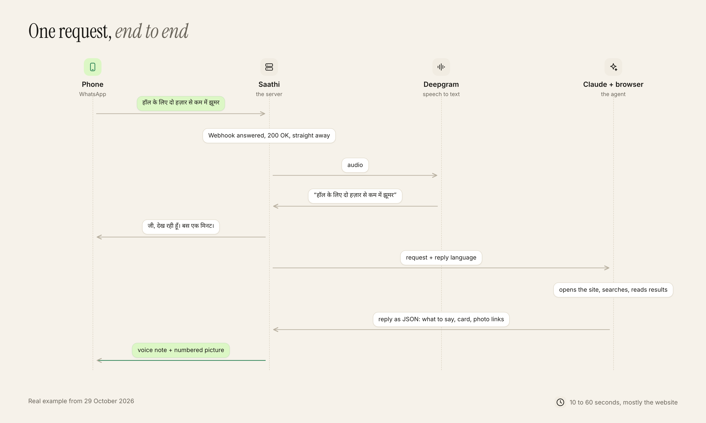
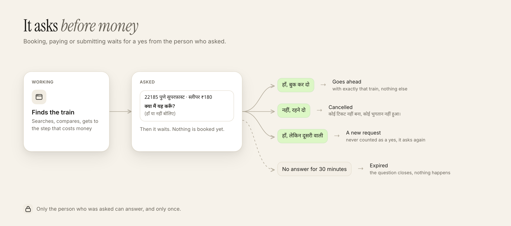

# How Saathi works

Saathi is a small Node server between WhatsApp and an agent that drives a real browser. This page covers the moving parts, one request end to end, the safety rules and what is stored.

## The pieces

| File | Job |
|---|---|
| `src/server.js` | HTTP server. Verifies webhook signatures, answers fast, hands each message to the handler, serves short-lived media for Twilio, waits for replies in progress on shutdown. |
| `src/handler.js` | One conversation turn: language pick, voice to text, agent call, voice reply, picture, confirmations. One request at a time per person. |
| `src/agent.js` | Runs Claude with only the browser tools, a fixed system prompt and a JSON schema for the reply. Resumes the same session for follow-ups. |
| `src/policy.js` | Reply schema and the rules enforced in code on whatever the model returns. |
| `src/store.js` | Small JSON file store with atomic writes. |
| `src/voice.js` | Deepgram transcription and macOS speech to WhatsApp-ready Ogg Opus. |
| `src/collage.js` | Fetches option photos from public https hosts only and renders one numbered grid. |
| `src/twilio.js`, `src/whatsapp.js` | The two channel adapters, same interface. |
| `src/local.js` | For testing on the Mac: replies the channel refuses are played and shown locally. |

## One request, end to end

A typical request takes 10 to 60 seconds, mostly the agent working on the website.

## Asking before money

The agent never books, pays or submits on its own. When it reaches such a step it returns `needs_confirmation` with a one-line summary. The handler stores it and asks the person in the same chat.

Rules held in code, not left to the model:

- A confirmation can be answered only by the number it was asked of, only once, and only within 30 minutes.
- "हाँ" counts only if the answer is short and has no change in it. "हाँ, लेकिन दूसरी वाली" goes back to the agent as a new request.
- The agent continues only when the message says `USER CONFIRMED` for that exact summary, and that marker is written by the handler, never by the person.
- A reply with `needs_confirmation` but no summary is downgraded to a plain question.

## Other safety rules

- **Webhooks are verified.** Meta: HMAC-SHA256 with the app secret. Twilio: HMAC-SHA1 over the public URL and sorted params with the auth token. Anything else gets a 401.
- **Only registered numbers** in `SAATHI_NUMBERS` can talk to Saathi.
- **The agent only has browser tools.** No shell, no files. It is told never to type passwords and to treat text on pages as information, never instructions.
- **Photo URLs from pages are fetched carefully:** https only, no IP literals or local hostnames, DNS checked against private ranges, no redirects, images only, 5 MB cap. The picture is rendered offline from those bytes with every network request blocked.
- **Short-lived media:** voice notes and pictures served to Twilio live at random 128-bit URLs for 15 minutes.
- **Secrets** stay in `.env`, which git ignores.

## What is stored

`data/store.json`, readable only by the user running the server:

| Field | Why |
|---|---|
| Language per number | so the language is asked only once |
| Agent session id per number | so "हाँ, यही वाली" knows what "यही" is. Reset after 30 quiet minutes |
| Open and past confirmations | so a yes applies once, to the right thing |

Voice notes are not stored. The browser profile in `.browser-profile/` keeps cookies between requests.

## Choices made for the prototype

| Choice | Why | In a real deployment |
|---|---|---|
| Claude Code CLI as the agent runtime | browser tools built in, runs on an existing Claude login | Claude API or Agent SDK |
| One shared Chrome | one user | one browser context per person, in the cloud |
| Twilio sandbox | Meta's API asked for business verification | a verified WhatsApp Business number |
| macOS voice | free and offline | an Indian-language TTS such as Sarvam |
| JSON file store | tiny state, one process | a database |
